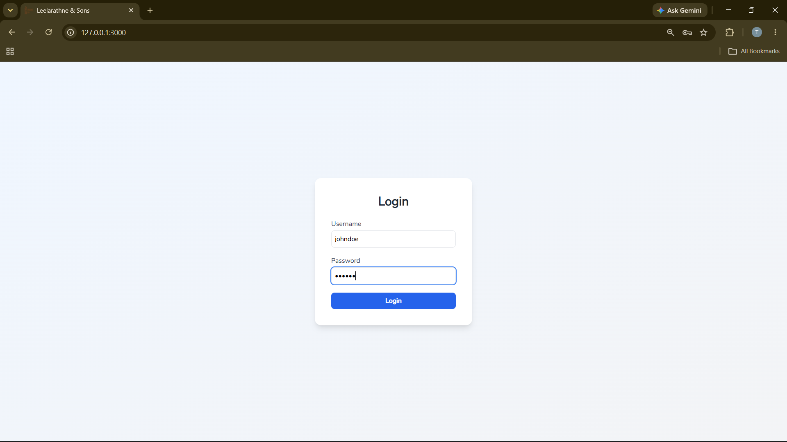
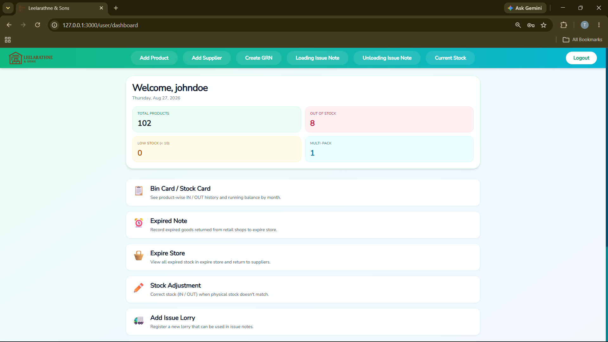
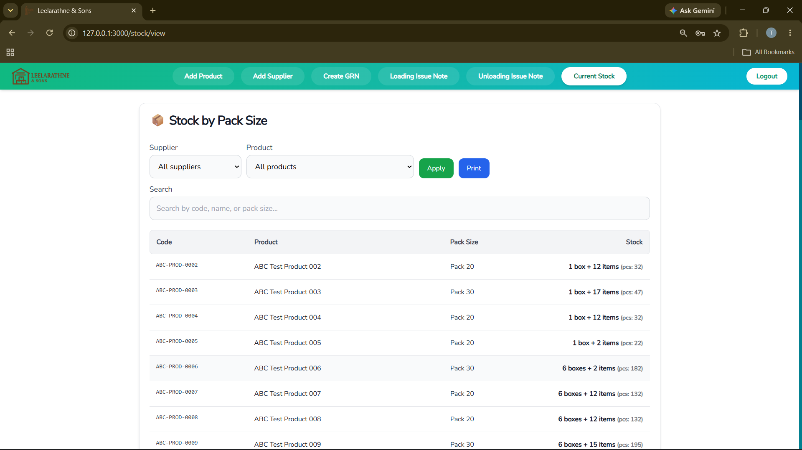
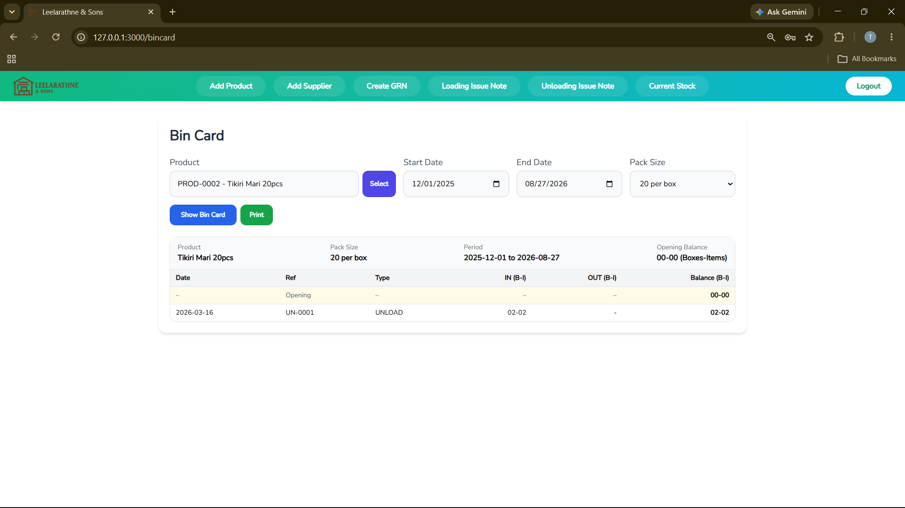
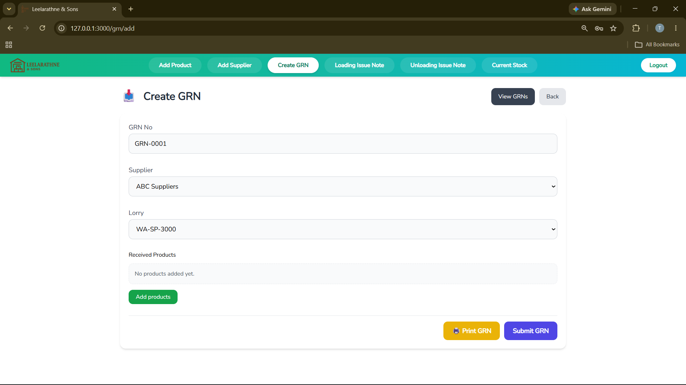
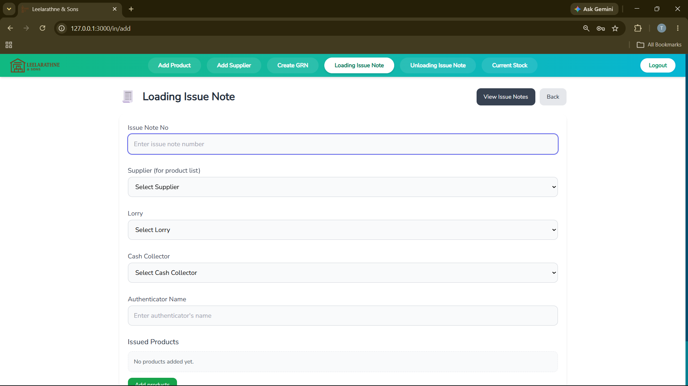
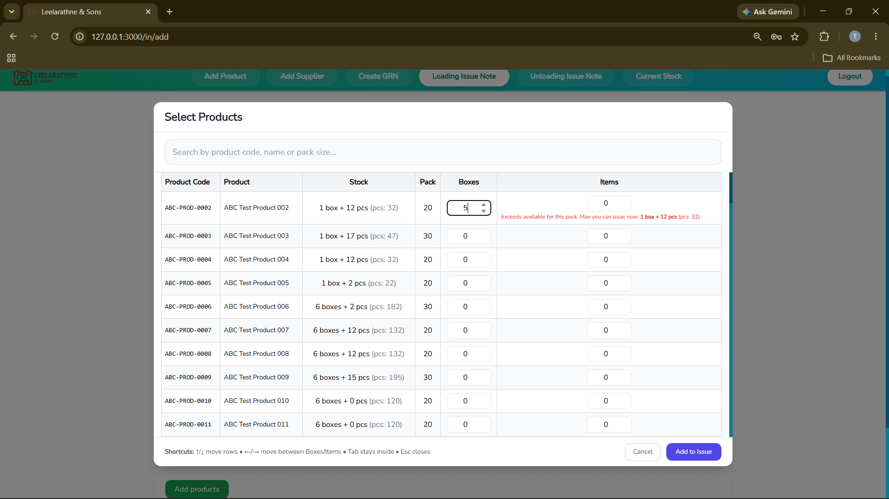
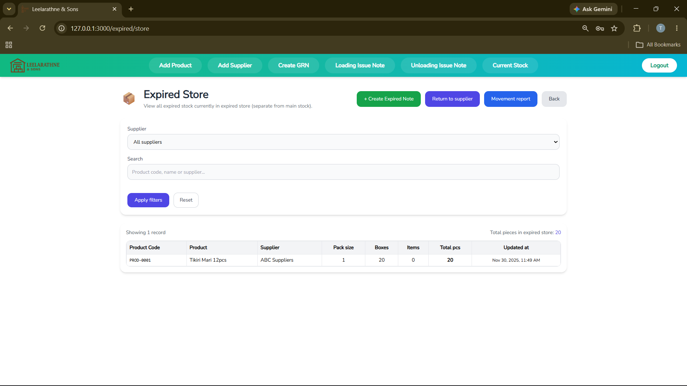

# Inventory & Warehouse Management System

A web-based inventory and warehouse management system developed as a freelance software project for a wholesale business. The system centralizes day-to-day warehouse operations, inventory management, stock movements, product and supplier management, expired stock handling, and printable operational documentation.

## Overview

The system supports day-to-day warehouse operations while maintaining accurate stock records at product, pack, box, and individual-item levels.

It provides dedicated workflows for receiving stock, issuing stock, monitoring current inventory, maintaining product-level Bin Cards, handling expired goods, supplier returns, stock adjustments, lorry management, and generating printable operational documents.

## Key Features

### Product Management

- Add and manage products
- Maintain product codes, names, and pack sizes
- Track inventory using boxes and individual items
- Support different pack sizes for different products
- Search and select products during inventory transactions

### Supplier Management

- Add and manage suppliers
- Associate products and stock transactions with suppliers
- Filter inventory information by supplier

### Goods Received Notes (GRN)

- Create GRNs for incoming stock
- Select the relevant supplier and lorry
- Add multiple products to a GRN
- Record pack size, boxes, and individual items received
- Update inventory through receiving transactions
- Generate print-ready GRNs
- Maintain GRN records for future reference

### Loading Issue Notes

- Create issue notes when stock is issued from the warehouse
- Select products and specify boxes/items to issue
- Validate requested quantities against available stock
- Prevent issuing quantities greater than available inventory
- Record supplier, lorry, cash collector, and authenticator details
- Generate printable issue notes
- Maintain issue-note records

### Unloading Issue Notes

- Record stock movements associated with unloading operations
- Track quantities using the box/item stock structure
- Maintain movement history for stock calculations

### Current Stock

- View current inventory across products
- Filter by supplier and product
- Search by product code, name, or pack size
- Display stock as full boxes, remaining items, and total pieces
- Provide a consolidated warehouse stock view

### Bin Card / Stock Card

- View product-level stock movement history
- Select a product and date range
- Display opening balance
- Track IN and OUT movements
- Calculate the running balance after each transaction
- Display balances using boxes and individual items
- Generate a printable Bin Card / Stock Card
- Provide a product-level summary of inventory activity

### Expired Store

- Maintain a separate store for expired inventory
- Record expired products returned from retail shops
- Keep expired stock separate from main inventory
- View expired quantities by product and supplier
- Search and filter expired inventory
- Return expired goods to suppliers
- Track expired-store movements

### Stock Adjustment

- Correct system stock when physical stock does not match recorded stock
- Support controlled inventory reconciliation

### Lorry Management

- Manage lorries used for warehouse operations
- Associate lorries with relevant GRNs and issue transactions

### Printing & Documentation

The system provides print-ready documents for operational use, including:

- Goods Received Notes (GRNs)
- Loading Issue Notes
- Unloading Issue Notes
- Bin Cards / Stock Cards
- Expired-stock movement records

## Inventory Tracking

Stock is maintained using:

**Boxes + Individual Items = Total Pieces**

The configured pack size is used consistently when calculating and displaying inventory across receiving, issuing, current-stock reports, and Bin Cards.

For example, if a product has a pack size of 20:

```text
1 box = 20 pieces

1 box + 12 items = 32 pieces
```

The configured pack size is used consistently throughout the system to calculate total pieces and maintain accurate stock balances.

## Stock Validation

Issue transactions are validated against the available stock.

For example, if a product has:

```text
1 box + 12 items
```

the system prevents a user from entering a quantity such as:

```text
5 boxes
```

and displays a validation message indicating that the requested quantity exceeds the available stock.

This helps prevent accidental over-issuing and improves inventory accuracy.

## Dashboard

The dashboard provides a centralized overview of the system, including:

- Total products
- Out-of-stock products
- Low-stock products
- Multi-pack products
- Quick access to Bin Cards / Stock Cards
- Expired Notes
- Expired Store
- Stock Adjustments
- Issue Lorry management

## Main Workflows

### Receiving Stock

```text
Supplier
   ↓
Create GRN
   ↓
Select Lorry
   ↓
Add Products
   ↓
Enter Boxes / Items
   ↓
Submit GRN
   ↓
Inventory Updated
```

### Issuing Stock

```text
Current Stock
   ↓
Create Issue Note
   ↓
Select Products
   ↓
Enter Boxes / Items
   ↓
Validate Available Stock
   ↓
Submit Issue Note
   ↓
Inventory Updated
```

### Stock Monitoring

```text
Stock Transactions
       ↓
  Current Stock
       ↓
   Bin Card
       ↓
IN / OUT History
       ↓
Running Balance
```

### Expired Stock

```text
Expired Goods
     ↓
Expired Note
     ↓
Expired Store
     ↓
Track Expired Stock
     ↓
Return to Supplier
```

## Core Modules

| Module | Purpose |
|---|---|
| Dashboard | Inventory overview and quick access |
| Products | Product and pack-size management |
| Suppliers | Supplier management |
| GRN | Record incoming stock |
| Loading Issue Note | Record stock issued from the warehouse |
| Unloading Issue Note | Record unloading-related movements |
| Current Stock | View and filter current inventory |
| Bin Card | Product-level stock movement history |
| Expired Note | Record expired goods |
| Expired Store | Manage separated expired inventory |
| Stock Adjustment | Reconcile physical/system stock |
| Issue Lorry | Manage lorries used for issue operations |
| Printing | Generate operational documents |

## Highlights

- End-to-end warehouse inventory workflow
- Transaction-based stock tracking
- Box and individual-item calculations
- Real-time quantity validation during issuing
- Product-level running balances
- Separate expired-stock management
- Supplier return workflow
- Search and filtering across inventory data
- Print-ready business documentation
- Centralized operational dashboard

## Technology Stack

### Frontend

- React.js
- JavaScript
- Redux
- Axios
- Tailwind CSS
- CSS

### Backend

- Node.js
- Express.js
- JavaScript
- REST APIs

### Database

- SQLite
- SQLite3

### Authentication & Security

- JSON Web Tokens (JWT)
- bcrypt
- Role-based access control
- Protected routes

### Development Tools

- Git
- GitHub
- npm
- Make
- Local deployment scripts

## Architecture

The application follows a full-stack client-server architecture:

```text
┌─────────────────────────────┐
│       React Frontend        │
│                             │
│ Components / Pages / Redux  │
└──────────────┬──────────────┘
               │
               │ REST API
               ↓
┌─────────────────────────────┐
│      Node.js + Express      │
│                             │
│ Authentication / Business   │
│ Logic / API Routes          │
└──────────────┬──────────────┘
               │
               ↓
┌─────────────────────────────┐
│          SQLite             │
│                             │
│ Products / Stock / Users    │
│ Suppliers / Transactions    │
└─────────────────────────────┘
```

## Screenshots

### Login



### Dashboard



### Current Stock



### Bin Card / Stock Card



### Goods Received Note (GRN)



### Loading Issue Note



### Product Selection & Stock Validation



### Expired Store



## Project Structure

```text
ERP System/
│
├── client/
│   ├── public/
│   └── src/
│       ├── Components/
│       ├── Hooks/
│       ├── Pages/
│       ├── State/
│       ├── assets/
│       └── utils/
│
├── server/
│   ├── public/
│   └── src/
│       ├── middleware/
│       ├── modules/
│       ├── routes/
│       └── utils/
│
├── screenshots/
│   ├── login.png
│   ├── dashboard.png
│   ├── current-stock.png
│   ├── bin-card.png
│   ├── grn.png
│   ├── loading-issue-note.png
│   ├── stock-validation.png
│   └── expired-store.png
│
├── .gitignore
├── README.md
├── localDeploy.md
├── localdeployScript.bat
├── makefile
├── package.json
└── package-lock.json
```

## Installation

### Prerequisites

- Node.js
- npm
- Git

### Clone the Repository

```bash
git clone <repository-url>
cd ERP-System
```

### Install Dependencies

Install the root dependencies:

```bash
npm install
```

Install the frontend dependencies:

```bash
cd client
npm install
```

Return to the root directory:

```bash
cd ..
```

Install the backend dependencies:

```bash
cd server
npm install
```

Return to the root directory:

```bash
cd ..
```

### Environment Configuration

Configure the required environment variables according to the project's backend configuration.

Sensitive credentials and secrets should not be committed to the repository.

### Running the Application

Start the backend server and frontend using the project's configured npm scripts.

For the project's local deployment configuration, refer to:

```text
localDeploy.md
```

## Database

The application uses SQLite for database operations.

The database manages information related to:

- Users
- Products
- Suppliers
- Inventory
- GRNs
- Issue notes
- Unloading records
- Expired stock
- Stock adjustments
- Lorries
- Stock movement history

The project also contains database initialization and seed scripts used during development and testing.

## Authentication

The system includes authentication and protected routes.

Authentication uses:

- JWT-based authentication
- bcrypt password hashing
- Protected API routes
- Role-based access control

Administrative functionality is protected separately from standard user functionality.

## Operational Documentation

The application supports the generation of standardized documents used during warehouse operations.

### Goods Received Notes

Used to document stock received from suppliers.

### Loading Issue Notes

Used to document stock issued from the warehouse.

### Unloading Issue Notes

Used to record stock movements associated with unloading operations.

### Bin Cards / Stock Cards

Used to maintain product-level inventory movement history and running balances.

### Expired Stock Records

Used to document expired inventory movements and supplier returns.

## Inventory & Transaction Flow

```text
                    ┌──────────────┐
                    │     GRN      │
                    │ Incoming IN  │
                    └──────┬───────┘
                           │
                           ↓
                    ┌──────────────┐
                    │    Current   │
                    │     Stock    │
                    └──────┬───────┘
                           │
              ┌────────────┼────────────┐
              ↓            ↓            ↓
       ┌────────────┐ ┌────────────┐ ┌────────────┐
       │   Issue    │ │ Adjustment │ │  Expired   │
       │   Notes    │ │            │ │   Stock    │
       └─────┬──────┘ └─────┬──────┘ └─────┬──────┘
             │              │              │
             └──────────────┼──────────────┘
                            ↓
                     ┌──────────────┐
                     │  Bin Card /  │
                     │ Stock History│
                     └──────────────┘
```

## Project Status

**Completed freelance software project.**

The system was developed for practical use in a wholesale warehouse environment.

## Author

Developed as a freelance software project.

## License

This project was developed for a client and is published on GitHub for portfolio and demonstration purposes.

---

The system was designed around practical warehouse workflows, with emphasis on accurate stock movement, operational validation, product-level traceability, expired-stock handling, supplier returns, inventory reconciliation, and standardized printable documentation.
